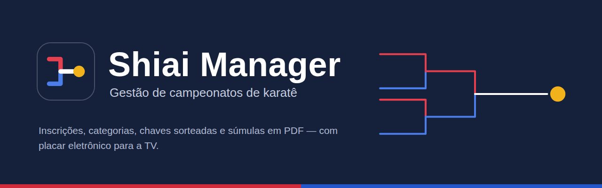
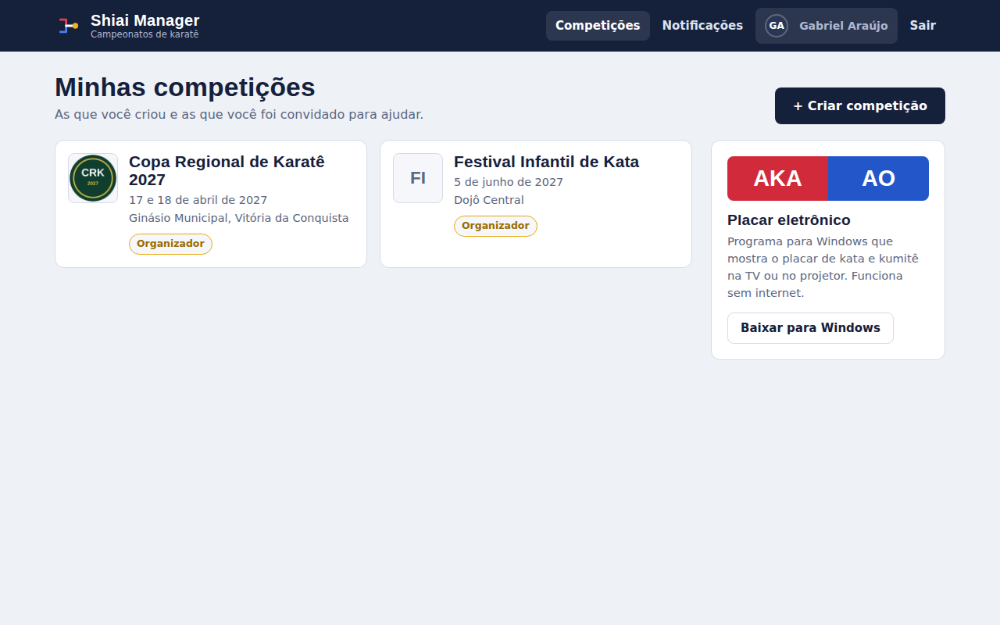
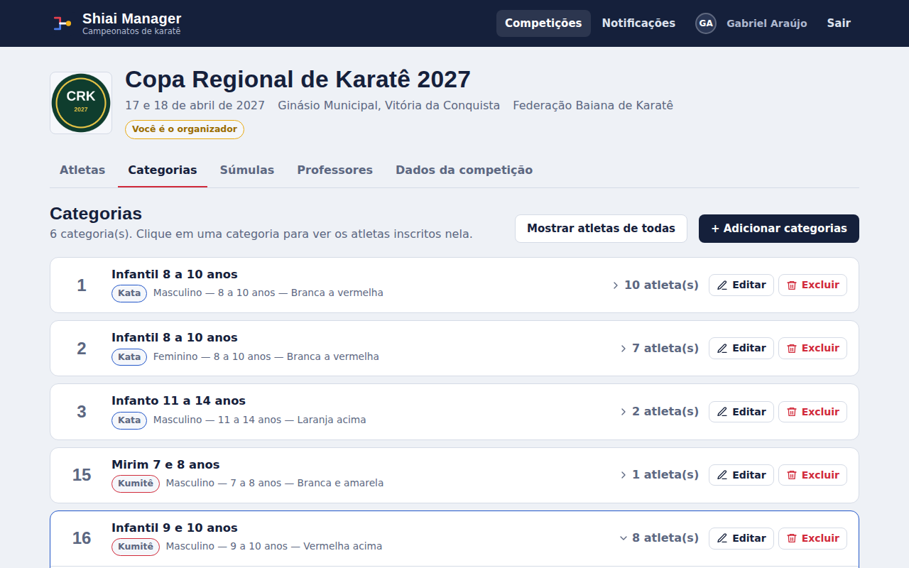
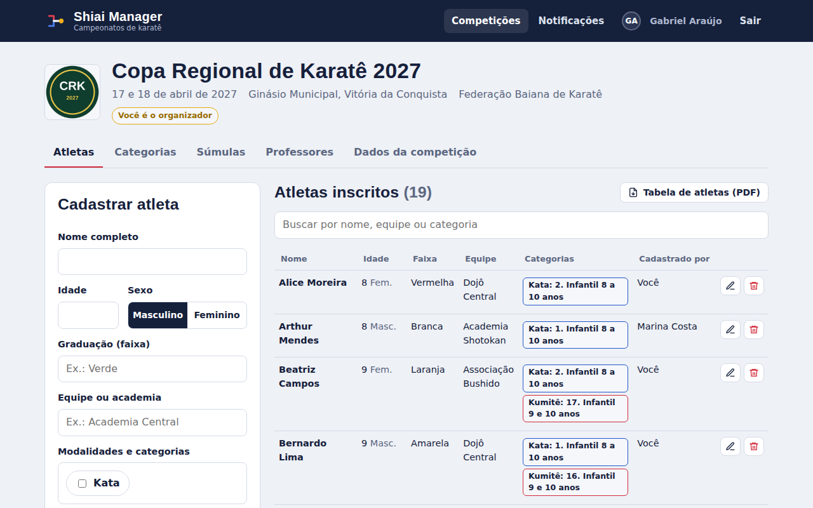
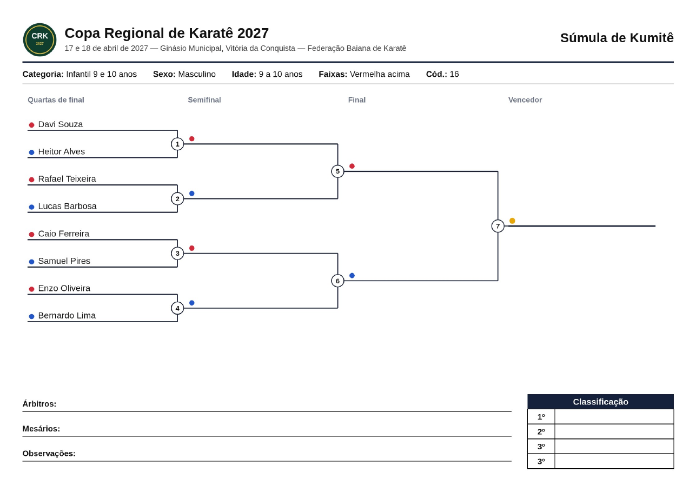
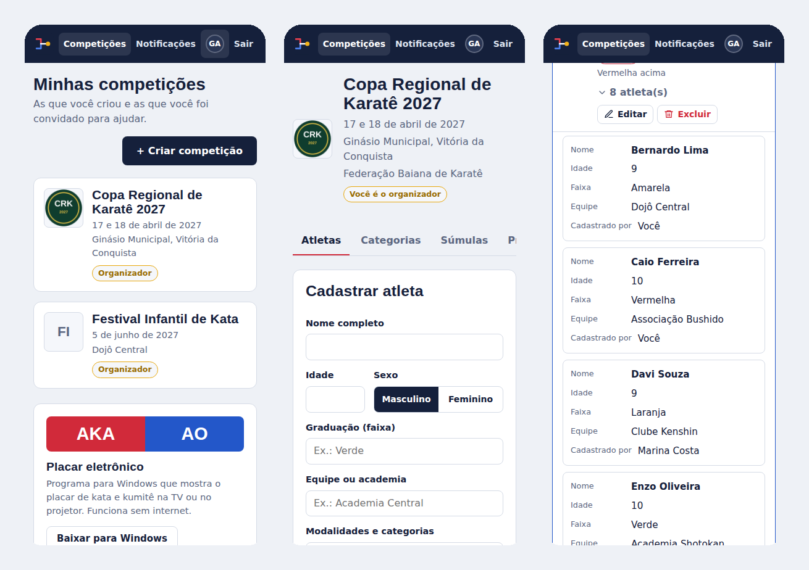
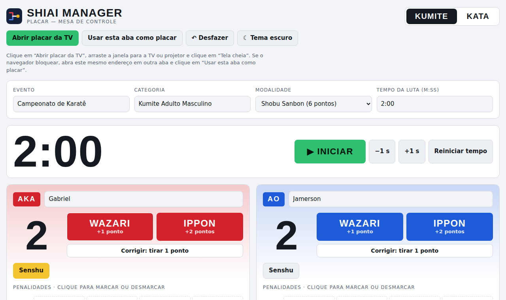

  

<h3 align="center">Do cadastro dos atletas à súmula impressa, num só lugar.</h3>

  
  &nbsp;
  

  
  
  
  

---

## 🥋 O que é o Shiai Manager

**Shiai** (試合) significa *competição* em japonês.

O **Shiai Manager** é um sistema gratuito para organizar campeonatos de karatê. O organizador cria a competição e as categorias, e cada professor inscreve os próprios alunos pela conta dele. No dia do evento, as chaves são sorteadas em um clique, as súmulas saem prontas em PDF e o placar eletrônico mostra as lutas na TV.

Não precisa instalar nada para usar o site: ele funciona no navegador do computador, do tablet e do celular.

  

## 📑 Neste manual

- [Primeiros passos](#primeiros-passos)
- [Guia do organizador](#organizador)
- [Guia do professor](#professor)
- [Minha conta](#conta)
- [Placar eletrônico](#placar)
- [Dicas para o dia do evento](#dicas)
- [Perguntas frequentes](#faq)
- [Suporte](#suporte)
- [Créditos](#creditos)

## 🚀 Primeiros passos

1. Acesse **[shiai-manager.pages.dev](https://shiai-manager.pages.dev)** e clique em **Criar conta**.
2. Preencha seu nome, e-mail e senha.
3. Abra o e-mail **"Shiai Manager: confirme sua conta"** e clique em **Confirmar minha conta**. Se não encontrar, olhe a pasta de spam.
4. Pronto: você já entra na tela **Minhas competições**.

> Organizadores e professores usam o **mesmo tipo de conta**. O que muda é o papel em cada competição: quem cria a competição é o organizador dela, e quem foi convidado é professor.

## 🏆 Guia do organizador

### 1. Criar a competição

Em **Minhas competições**, clique em **+ Criar competição** e preencha:

| Campo | Exemplo |
|---|---|
| Logo | A imagem do evento (PNG ou JPG) |
| Nome | Copa Regional de Karatê 2027 |
| Local | Ginásio Municipal, Vitória da Conquista |
| Data | Um ou mais dias (**+ Adicionar outro dia**) |
| Federação | Federação Baiana de Karatê |
| Categorias | Já pode criar aqui ou depois |

### 2. Montar as categorias

Na aba **Categorias**, clique em **+ Adicionar categorias**. Cada categoria tem:

- **Código:** o número que aparece na súmula. Deixe em branco para numerar automaticamente.
- **Nome**, **modalidade** (Kata ou Kumitê) e **sexo** (masculino, feminino ou misto).
- **Idade de / até** e, se quiser, as **faixas** aceitas.

Use **+ Adicionar outra categoria** para cadastrar várias de uma vez. Clique numa categoria para ver os atletas inscritos nela, ou em **Mostrar atletas de todas**.

  

### 3. Convidar os professores

Na aba **Professores**, digite o e-mail da conta do professor e clique em **Enviar convite**. O convite aparece em **Notificações**, na conta dele.

- O professor precisa **já ter conta** no Shiai Manager, com o e-mail confirmado.
- Depois de aceitar, ele só vê e edita **os atletas que ele mesmo cadastrou**.
- Você pode cancelar um convite ou remover um professor a qualquer momento. Os atletas que ele cadastrou continuam inscritos.

### 4. Acompanhar as inscrições

A aba **Atletas** mostra todos os inscritos, quem cadastrou cada um e em quais categorias estão. Use a busca para achar por nome, equipe ou categoria.

O botão **Tabela de atletas (PDF)** gera a lista completa em ordem alfabética, com as categorias de Kata e Kumitê de cada atleta. Na janela de impressão, escolha **Salvar como PDF**.

  

### 5. Gerar as súmulas

Na aba **Súmulas**:

1. Clique em **Sortear todas**. O sistema monta as chaves de todas as categorias e tenta evitar que atletas da mesma equipe se enfrentem logo na primeira luta.
2. Escolha como baixar:
   - **Baixar PDF:** a súmula da categoria selecionada.
   - **Todas em um único PDF:** uma página por categoria, pronto para imprimir.
   - **Todas em ZIP:** um arquivo por categoria, cada um com o nome dela.
3. Precisa refazer? Use **Sortear de novo** numa categoria, ou **Apagar** para descartar o sorteio. Os atletas continuam inscritos.

Se alguém for inscrito ou removido depois do sorteio, a categoria fica marcada com um aviso para você sortear de novo. A opção **Súmula em branco** gera uma chave vazia para preencher à mão.

   
  Súmula em A4 deitado: ordem das lutas, cores AKA e AO, árbitros, mesários e classificação.

### 6. Editar ou excluir a competição

Na aba **Dados da competição**, você muda o nome, o local, as datas, a federação e a logo. Lá também fica a opção de **excluir a competição**, que apaga tudo o que há nela e não pode ser desfeita.

## 👨‍🏫 Guia do professor

1. **Aceite o convite:** abra **Notificações** no topo da tela e clique em **Aceitar**.
2. **Cadastre os alunos:** na competição, preencha nome, idade, sexo, faixa e equipe. Marque **Kata**, **Kumitê** ou os dois. O sistema sugere a categoria certa pela idade e pelo sexo; confira se a faixa combina.
3. **Edite quando precisar:** use ✏️ para corrigir um cadastro e 🗑️ para remover.

> **O mesmo aluno em Kata e Kumitê:** marque os dois de uma vez. Se você cadastrar o aluno de novo em outra modalidade, o sistema pergunta se quer **juntar no mesmo cadastro**. Assim ele não aparece duplicado.

   
  Dá para inscrever os alunos pelo celular.

## 👤 Minha conta

Clique na sua foto ou no seu nome, no topo da tela:

- **Foto e nome:** troque e clique em **Salvar perfil**.
- **Senha:** clique em **Enviar link para trocar a senha** e abra o e-mail que chegar. Esqueceu a senha? Use **Esqueci minha senha** na tela de entrada.
- **Excluir conta:** digite sua senha para confirmar. As competições que você organiza são apagadas junto.

## 🖥️ Placar eletrônico

  

Programa para Windows que mostra as lutas na TV ou no projetor. **Funciona sem internet.**

### Instalar
1. **[Baixe o Shiai Manager para Windows](https://github.com/gabrielwhz/shiai-manager/releases/latest/download/Shiai.Manager.-.EXTRAIA.zip)**.
2. Clique com o botão direito no arquivo baixado e escolha **Extrair tudo**.
3. Abra a pasta e dê dois cliques em **`Shiai Manager.exe`**. Não mexa na pasta `Arquivos`.

> Na primeira vez, o Windows pode mostrar *"O Windows protegeu o computador"*. Clique em **Mais informações → Executar assim mesmo**.

### Ligar na TV
1. Conecte a TV ou o projetor pelo cabo HDMI.
2. Aperte <kbd>Windows</kbd> + <kbd>P</kbd> e escolha **Estender**.
3. No programa, clique em **Abrir placar da TV**. O placar abre sozinho em tela cheia na TV.

### Usar
| Kumitê | Kata |
|---|---|
| Wazari (+1) e Ippon (+2) | Avaliação por bandeiras ou por notas |
| Senshu e penalidades | Nome do atleta e kata apresentado |
| Cronômetro, ajuste de ±1 s | Atleta que está apresentando |
| Tela de vencedor e empate | Tela de vencedor |

Nas duas modalidades:
- **⇄ Inverter cores:** troca tudo do AKA para o AO, e vice-versa.
- **↶ Desfazer:** volta a última ação.
- **Tema escuro:** muda as cores da mesa de controle.
- **Tela cheia:** dois cliques no placar entram ou saem da tela cheia, e <kbd>Esc</kbd> sai.

Os dados da luta ficam salvos mesmo se o programa for fechado.

## ✅ Dicas para o dia do evento

- **Feche as inscrições** antes de sortear, combinando um prazo com os professores.
- **Sorteie e baixe as súmulas na véspera** e imprima em A4, folha deitada.
- **Baixe também o ZIP** e guarde no pendrive: é uma cópia de segurança, uma súmula por arquivo.
- **Imprima a Tabela de atletas** para a mesa de recepção conferir os nomes.
- **Teste o placar na TV do local** antes do evento: cabo HDMI e Windows + P.
- **Leve algumas súmulas em branco** para imprevistos.

## ❓ Perguntas frequentes

<b>O Shiai Manager é pago?</b>

Não. O uso é gratuito.

<b>O e-mail de confirmação ou de senha não chegou.</b>

Espere alguns minutos e olhe a pasta de **spam** e a aba **Promoções**. Na tela de entrada, você pode pedir um novo e-mail em **Reenviar e-mail de confirmação**.

<b>Convidei um professor e apareceu "não existe conta com esse e-mail".</b>

O professor precisa criar a conta e confirmar o e-mail antes. Confira também se o e-mail digitado é exatamente o da conta dele.

<b>O professor consegue ver os atletas de outras equipes?</b>

Não. Cada professor vê somente os atletas que ele cadastrou. Só o organizador vê todos.

<b>Um atleta não combina com nenhuma categoria. E agora?</b>

O organizador pode criar a categoria que falta, ou o professor pode escolher manualmente em **Outras categorias**, na lista de categorias do cadastro.

<b>Posso refazer o sorteio?</b>

Sim, quantas vezes quiser, por categoria (**Sortear de novo**) ou todas de uma vez (**Sortear todas → Sortear todas de novo**).

<b>O placar funciona no Mac ou no Linux?</b>

Por enquanto, o placar eletrônico é só para Windows (7, 8, 10 e 11, 64 bits).

<b>Meus dados estão seguros?</b>

Cada pessoa acessa somente o que pertence a ela: o professor vê os próprios atletas, e o organizador vê a competição que criou. As senhas não ficam visíveis para ninguém, nem para a equipe do Shiai Manager.

## 💬 Suporte

Encontrou um problema ou tem uma sugestão?

- ✉️ **E-mail:** [shiaimanager@gmail.com](mailto:shiaimanager@gmail.com)
- 🐞 **Relatar um problema:** abra uma [issue](../../issues) aqui no GitHub, contando o que aconteceu e, se puder, com um print da tela.

As novidades de cada versão do placar ficam em [Releases](../../releases).

## 🙏 Créditos

**Criado e desenvolvido por [Gabriel Araújo](https://github.com/gabrielwhz).**

O Shiai Manager nasceu da organização da **I Copinha ASDOKS**. Obrigado aos professores, atletas e organizadores que testaram e ajudaram a moldar o sistema.

Construído com: [Supabase](https://supabase.com) · [Cloudflare Pages](https://pages.cloudflare.com) · [Brevo](https://www.brevo.com) · [Electron](https://www.electronjs.org) · fonte [Barlow](https://fonts.google.com/specimen/Barlow), de Jeremy Tribby.

## 📄 Licença

© 2026 Gabriel Araújo. Todos os direitos reservados. Veja os termos em [LICENSE](LICENSE).

  <b>Shiai Manager</b> · Oss! 🥋

